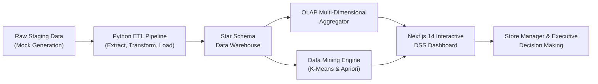
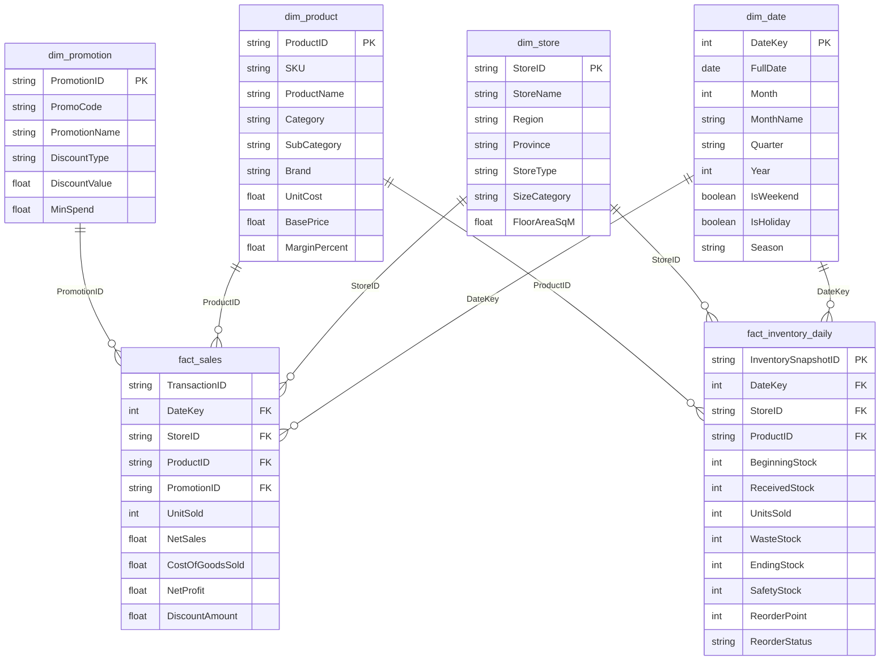

# QuickMart Retail Insight DSS (Decision Support System)

[](#vercel-deployment)
[](https://nextjs.org/)
[](https://tailwindcss.com/)
[](#data-mining--machine-learning)
[](#bilingual-system-thai--english)

An end-to-end, enterprise-grade Decision Support System (DSS) tailored for **QuickMart**, a simulated 10-branch convenience retail chain operating across Thailand. The system ingests 9 months of granular transactional and inventory data (Jan 1 – Sep 30, 2026; 273 days, 65 SKUs across 8 categories), transforms it into a Star Schema Data Warehouse, performs OLAP multi-dimensional slicing/dicing, applies K-Means Clustering and Apriori Association Rule Mining, and delivers actionable merchandising and inventory recommendations through an interactive Next.js dashboard with full bilingual (Thai 🇹🇭 / English 🇺🇸) support.

---

## 1. Executive Summary & Ground Truth Baselines

All analytics, reports, and UI dashboards reconcile against verified Data Warehouse baseline metrics:

| Metric | Validated Baseline Ground Truth | Source of Truth Formula |
| :--- | :--- | :--- |
| **Dim_Date Rows** | **273 rows** | Daily calendar entries (2026-01-01 to 2026-09-30) |
| **Dim_Product SKUs** | **65 SKUs** | Commercial assortment across 8 categories |
| **Dim_Store Branches** | **10 branches** | 10 stores across Thailand |
| **Dim_Promotion Rows** | **7 rows** | `PRM000` to `PRM006` |
| **Fact_Sales Line Items** | **51,551 line items** | Transaction line items (baskets $\times$ SKUs) |
| **Fact_Inventory Snapshots** | **177,450 snapshots** | $65\text{ SKUs} \times 10\text{ Stores} \times 273\text{ Days}$ |
| **Total Units Sold** | **71,885 units** | $\sum \text{UnitSold}$ (Fact_Sales) |
| **Total Transactions** | **26,327 baskets** | $\text{COUNT}(\text{DISTINCT TransactionID})$ |
| **Total Net Sales** | **฿1,595,166.51** | $\sum \text{NetSales}$ |
| **Total Net Profit** | **฿499,676.51** | $\sum \text{NetProfit}$ |
| **Gross Profit Margin** | **31.32%** | $(\text{NetProfit} / \text{NetSales}) \times 100$ |
| **Average Basket Value** | **฿60.59 / basket** | $\text{Total Net Sales} / \text{Total Transactions}$ |
| **Average Basket Size** | **2.73 units / basket** | $\text{Total Units Sold} / \text{Total Transactions}$ |
| **Ending Stock On Hand (Snapshot)** | **29,796 units** | $\sum \text{EndingStock}$ on $\text{DateKey} = 20260930$ |
| **Average Daily Stock On Hand** | **45.44 units/item/day** | Semi-additive temporal average over 273 days |

---

## 2. End-to-End System Workflow



1. **Phase 2: Staging & Synthetic Generation**: 273 calendar days of point-of-sale line items and daily inventory balances across 10 Thai branches and 65 merchandise SKUs.
2. **Phase 3: ETL Pipeline & Data Warehouse**: Cleanses, standardizes, validates referential integrity, and commits data into a Star Schema / Fact Constellation.
3. **Phase 4: OLAP Analysis**: Executes Slice, Dice, Drill-down, and Roll-up operations; computes Regional Fairness (Total vs. Average Revenue per Store) and semi-additive inventory snapshots.
4. **Phase 5: Data Mining**: Implements K-Means Product Clustering ($K=3$) and Apriori Market Basket Association Rule Mining (Lift up to 10.74).
5. **Phase 6: Interactive DSS Dashboard**: Modern Next.js application with 4 specialized analytical views, instant Thai/English language toggle, and DSS advisory recommendations.
6. **Phase 7: Production Optimization & Deployment**: Static asset packaging, zero hardcoded secrets, deploy-ready Vercel build configuration, and technical documentation.

---

## 3. Data Warehouse Architecture (Star Schema / Fact Constellation)

The warehouse implements a **Fact Constellation (Galaxy Schema)** featuring **two central fact tables** sharing **four conformed dimension tables**:



### Table Inventory & Cardinality

- **`dim_date`** (273 rows): Daily grain from 2026-01-01 to 2026-09-30, with Thailand seasons and statutory holidays.
- **`dim_store`** (10 rows): Physical branch profiles spanning Central, North, Northeast, South, and East regions.
- **`dim_product`** (65 rows): SKU catalog across 8 categories (*Beverages, Snacks, Instant Food, Ready-to-Eat, Bakery, Dairy & Chilled, Personal Care, Household*).
- **`dim_promotion`** (7 rows): Marketing campaign mechanisms (`PRM000` to `PRM006`).
- **`fact_sales`** (51,551 line items): Transaction item sales rows representing **71,885 total physical units sold** across 26,327 checkout baskets.
- **`fact_inventory_daily`** (177,450 snapshots): Daily stock balances ($65\text{ SKUs} \times 10\text{ Stores} \times 273\text{ Days}$) adhering to the inventory flow equation:
  $$\text{EndingStock}_t = \text{BeginningStock}_t + \text{ReceivedStock}_t - \text{UnitsSold}_t - \text{WasteStock}_t$$

---

## 4. Semi-Additive Measure Ground Rules

> [!CAUTION]
> **Semi-Additive Nature of Inventory Measures**
> - `BeginningStock` and `EndingStock` represent point-in-time states.
> - **NEVER SUM ACROSS TIME**: Summing ending stock across 273 days produces a meaningless inflated number.
> - **Permitted Aggregations**:
>   - Sum across `StoreID` or `Category` for a **specific fixed date** (Point-in-Time Snapshot):
>     $$\text{Total Chain Stock}_{t=2026-09-30} = \sum_{s \in \text{Stores}} \sum_{p \in \text{Products}} \text{EndingStock}_{s,p,t} = \mathbf{29,796\text{ units}}$$
>   - Average across time for a store or SKU (Daily Average Stock):
>     $$\overline{\text{EndingStock}} = \frac{1}{|T|} \sum_{t \in T} \text{EndingStock}_{s,p,t} = \mathbf{45.44\text{ units/item/day}}$$

---

## 5. OLAP Multi-Dimensional Analytics

The OLAP engine supports four fundamental operations:
1. **Slice**: Isolating a single dimension (e.g., examining April 2026 sales or filtering specifically for the `Beverages` category).
2. **Dice**: Selecting multi-dimensional sub-cubes (e.g., `Region = Central` **AND** `Category = Ready-to-Eat` **AND** `IsWeekend = True`).
3. **Drill-Down**: Traversing from coarse to fine granularity (Quarter $\rightarrow$ Month $\rightarrow$ Day; Category $\rightarrow$ SubCategory $\rightarrow$ SKU).
4. **Roll-Up**: Summarizing store-level line items into regional totals and chain-wide summaries.

### Regional Fairness Metric (Total vs. Average per Store)
When regions have unequal store allocations (e.g., Central has 4 branches while North has 2), raw revenue totals distort productivity evaluations. The DSS includes a toggle between **Total Revenue** and **Average Revenue per Branch** ($\frac{\text{Regional Sales}}{\text{Branch Count}}$) to enable fair store efficiency assessments.

---

## 6. Data Mining & Machine Learning

### 6.1 K-Means Product Clustering ($K=3$)
Identifies distinct merchandise segments from standardized sales velocity, margin %, and revenue volume across all 65 SKUs:
- **Cluster 0: Core Volume Anchors (11 SKUs)**: High turnover, 44.8% unit volume (32,177 units), 50.9% revenue share, 28.81% margin. *Recommendation: Prioritize zero-stockout mandate, maintain safety buffers, and eye-level shelf placement.*
- **Cluster 1: Long-Tail Assortment (43 SKUs)**: 18.0% unit volume (12,958 units), 25.0% revenue share, 31.15% margin. *Recommendation: Review lean inventory replenishment, rationalizing shelf space, and quarterly assortment reviews.*
- **Cluster 2: High Margin Boosters (11 SKUs)**: 37.2% unit volume (26,750 units), 24.1% revenue share, **36.36% profit margin**. *Recommendation: Position near checkout counters / endcaps, and pair with Cluster 0 core staples.*

### 6.2 Market Basket Analysis (Apriori Association Rules)
Mined from 26,327 checkout baskets with validated Ground Truth thresholds:
- **Minimum Support $\ge 0.02$** ($\ge 526$ transactions)
- **Minimum Confidence $\ge 0.30$** ($\ge 30.0\%$ conditional probability)
- **Minimum Lift $> 1.00$** (Statistical affinity over independence)

Key Findings:
- 20 strong actionable rules discovered with Lift scores up to **10.74**.
- Top associations:
  - *CP Sausage Roll Pastry 80g $\rightarrow$ Nescafe Espresso Roast 180ml* ($\text{Lift} = 10.74$, Confidence: 84.31%)
  - *Le Pan Butter Sponge Cake 65g $\rightarrow$ Meiji Chocolate Milk 450ml* ($\text{Lift} = 10.62$, Confidence: 84.22%)
  - *Farmhouse White Bread 480g $\rightarrow$ Meiji Fresh Milk 450ml* ($\text{Lift} = 6.33$, Confidence: 50.20%)
  - *Oishi Green Tea Honey Lemon 500ml $\rightarrow$ Bento Squid Sweet & Spicy 20g* ($\text{Lift} = 6.26$, Confidence: 50.30%)
  - *Betagro Boiled Egg 2-pack 100g $\rightarrow$ Mama Minced Pork Noodles 67g* ($\text{Lift} = 6.07$, Confidence: 48.17%)
- **Interactive Bundle & Cross-Selling Advisor**: Allows store managers to pick any SKU and immediately displays complementary recommendations, confidence rates, lift scores, and non-mandatory advisory suggestions.

---

## 7. Interactive DSS Dashboard Pages

| Page Route | View Title | Key Capabilities & Features |
| :--- | :--- | :--- |
| **`/`** | **Executive Overview** | 8 KPI Cards, Monthly Sales Trend with Margin overlay, Category Revenue distribution, Top 5 SKUs, Donut Inventory Health, DSS AI Insights Panel |
| **`/sales`** | **Sales & OLAP Analytics** | Interactive Month/Region/Category/Weekend filters, Monthly Margin %, Regional Fairness toggle, Branch Leaderboard, Promo Effectiveness Table |
| **`/inventory`** | **Inventory & Replenishment** | Semi-additive metrics, Store/Category filters, Ending Stock trend, Reorder Alert Tabs (`REORDER`, `OUT_OF_STOCK`, `OVERSTOCK`, `ALL`), Action Badges |
| **`/mining`** | **Data Mining & Bundling** | K-Means 2D Scatter Plot, Segment profiles, Apriori Association Rules table (sortable by Lift/Confidence), Interactive Cross-Sell Advisor |

---

## 8. Bilingual System (Thai 🇹🇭 / English 🇺🇸)

QuickMart DSS incorporates an enterprise bilingual localization architecture:
- **Instant Reactive Switching**: Global Header toggle (`🇹🇭 TH` / `🇺🇸 EN`) updates the entire interface without page reload.
- **Centralized Dictionary**: Over 200 translated strings in `lib/i18n/translations.ts` covering KPIs, charts, table columns, tooltips, and advisory notes.
- **Persistent Preferences**: Stores language choice in `localStorage` under `quickmart-language`.
- **DSS Advisory Tone**: Carefully structured advisory phrasing preserving human decision agency:
  - **English**: *"May consider..."*, *"Could review..."*, *"Suggested action..."*
  - **Thai**: *"ควรพิจารณา..."*, *"อาจพิจารณา..."*, *"ข้อเสนอแนะสำหรับการตัดสินใจ..."*

---

## 9. Technology Stack

- **Frontend / Fullstack**: [Next.js 14.2](https://nextjs.org/) (App Router), [React 18](https://react.dev/), [TypeScript 5](https://www.typescriptlang.org/)
- **Styling**: [Tailwind CSS 3.4](https://tailwindcss.com/), [PostCSS](https://postcss.org/)
- **Visualizations**: [Recharts 2.13](https://recharts.org/), [Lucide React](https://lucide.dev/) icons
- **Data Engineering / ML**: Python 3.10+, Pandas, NumPy, Scikit-learn, Mlxtend
- **Deployment Platform**: [Vercel](https://vercel.com/) (Edge-ready static and serverless build)

---

## 10. Installation & Local Setup

### Prerequisites
- [Node.js](https://nodejs.org/) v18+ (tested on Node v24.19)
- [Python](https://www.python.org/) 3.10+ (for running ETL or Data Mining scripts)
- [npm](https://www.npmjs.com/) v9+

### Step-by-Step Instructions

1. **Clone the Repository**:
   ```bash
   git clone https://github.com/your-username/quickmart-dss.git
   cd quickmart-dss
   ```

2. **Install Node.js Dependencies**:
   ```bash
   npm install
   ```

3. **Run the Next.js Development Server**:
   ```bash
   npm run dev
   ```
   Open [http://localhost:3000](http://localhost:3000) in your web browser.

4. **Build & Run Production Server Locally**:
   ```bash
   npm run build
   npm run start
   ```

5. *(Optional)* **Run Python Pipeline Scripts**:
   ```bash
   # Execute ETL Pipeline
   python etl/run_etl.py

   # Execute OLAP Aggregation
   python olap/run_olap.py

   # Execute Data Mining (K-Means & Apriori)
   python mining/run_data_mining.py
   ```

---

## 11. Vercel Deployment

The application is fully configured for production deployment on Vercel:

### Option A: One-Click Git Deployment (Recommended)
1. Push this repository to GitHub or GitLab.
2. Log into [vercel.com](https://vercel.com) and click **"Add New Project"**.
3. Select your `quickmart-dss` repository.
4. Framework Preset will auto-detect as **Next.js**.
5. Click **"Deploy"**. The site will build and publish within 60 seconds.

### Option B: Deploy via Vercel CLI
```bash
# Log in to Vercel account
npx vercel login

# Deploy preview build
npx vercel

# Deploy directly to production
npx vercel --prod
```

---

## 12. Project Directory Structure

```text
quickmart-dss/
├── app/                      # Next.js App Router (4 routes)
│   ├── page.tsx              # Executive Overview (/)
│   ├── sales/page.tsx        # Multi-Dimensional OLAP Sales (/sales)
│   ├── inventory/page.tsx    # Inventory & Replenishment Monitor (/inventory)
│   ├── mining/page.tsx       # Data Mining & Bundling Advisor (/mining)
│   ├── layout.tsx            # Global Layout & Providers
│   └── globals.css           # Global Tailwind CSS Styles
│
├── components/               # Modular UI Components
│   ├── layout/
│   │   ├── Header.tsx        # Global Header with EN/TH Toggle
│   │   └── Sidebar.tsx       # Navigation Menu
│   └── ui/                   # Reusable Cards, Buttons, and Badges
│
├── lib/                      # Core Business Logic & Providers
│   ├── context/
│   │   └── LanguageContext.tsx # Bilingual Provider (React Context)
│   ├── i18n/
│   │   └── translations.ts   # Centralized Dictionary (200+ keys)
│   └── dataProvider.ts       # Client data fetcher & baseline calculations
│
├── public/data/              # Production Static Data Assets (JSON/CSV)
│   ├── olap/                 # Pre-computed OLAP Cubes
│   └── mining/               # K-Means Clusters & Apriori Rules
│
├── docs/                     # Comprehensive Technical Documentation
│   ├── data_dictionary.md    # Full Data Dictionary for 6 Tables
│   ├── star_schema.md        # Star Schema / Fact Constellation Architecture
│   ├── etl_pipeline.md       # ETL Extraction, Transformation, Validation
│   ├── olap_analysis.md      # OLAP Operations, Fairness Metric & Logic
│   ├── data_mining.md        # K-Means and Apriori Mathematical Formulation
│   ├── dashboard_guide.md    # Store Manager User Manual
│   └── screenshots/          # Screenshot captures & guide
│
├── etl/                      # Python ETL Pipeline Engine
│   └── run_etl.py            # Master ETL script
├── olap/                     # Python OLAP Cubing Engine
│   └── run_olap.py           # Master OLAP script
├── mining/                   # Python Data Mining Engine
│   └── run_data_mining.py    # Master K-Means & Apriori script
│
├── prompts/                  # Prompt Engineering & Audit Portfolio (35%)
│   ├── phase3_etl_notes.md
│   ├── phase4_olap_notes.md
│   ├── phase5_data_mining_notes.md
│   ├── phase6_dashboard_notes.md
│   └── phase7_deployment_notes.md
│
├── reports/                  # Detailed Phase Analytical Reports
│   ├── phase4_olap_report.md
│   ├── phase5_data_mining_report.md
│   └── phase6_dashboard_report.md
│
├── .env.example              # Environment variables template
├── .gitignore                # Git exclusions (node_modules, .next, logs)
├── .vercelignore             # Vercel deployment exclusions
├── vercel.json               # Vercel production build configuration
├── next.config.mjs           # Next.js compiler settings
├── package.json              # Project manifest and scripts
├── tailwind.config.ts        # Tailwind theme tokens
└── README.md                 # Primary system documentation
```

---

## 13. System Limitations & Future Roadmap

1. **Simulated Synthetic Horizon**: The dataset covers 273 days of 2026. Future phases can connect to live POS and ERP APIs (e.g., SAP, Odoo) via scheduled webhooks.
2. **Batch Mining Pre-computation**: K-Means and Apriori rules are pre-computed daily or weekly. Future enhancements may incorporate online incremental stream mining.
3. **Advanced Forecast Models**: Future iterations could integrate ARIMA or Prophet time-series models for automated safety stock dynamic recalculation.

---

## 14. License & Credits

Developed as part of the **Decision Support System (DSS) Academic & Professional Portfolio** for Retail Analytics.  
Designed and built with modern Agentic Engineering and Data Warehouse best practices.
