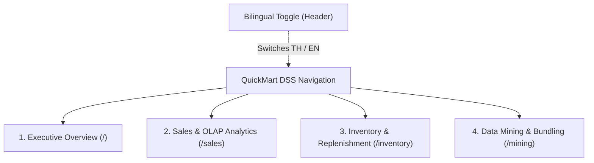

# QuickMart Decision Support System — User & Dashboard Guide

**System**: Retail Insight DSS — QuickMart  
**Target Users**: Retail Operations Directors, Regional Area Managers, Store Managers  
**URL**: Local `http://localhost:3000` / Vercel Production Deployment  
**Language Support**: Dual Language (Thai 🇹🇭 / English 🇺🇸)

---

## 1. Dashboard Architecture & Navigation

The QuickMart DSS is divided into four dedicated analytical views accessible from the persistent sidebar:

---

## 2. Page-by-Page Feature Guide

### 2.1 Page 1: Executive Overview (`/`)
Designed for C-level executives and General Managers requiring a high-level pulse of retail operations.

- **8 Executive KPI Cards**:
  1. **Total Net Sales**: `฿1,595,166.51`
  2. **Total Net Profit**: `฿499,676.51`
  3. **Gross Profit Margin**: `31.32%`
  4. **Total Units Sold**: `71,885 units`
  5. **Total Transactions**: `26,327 baskets`
  6. **Average Basket Value**: `฿60.59 / basket`
  7. **Ending Stock On Hand (Snapshot)**: `29,796 units` (as of Sep 30, 2026)
  8. **Average Daily Stock**: `45.44 units/item/day` (semi-additive temporal average)
- **Visual Analytics**:
  - *Monthly Revenue & Margin Trend*: Bar-and-line combination chart showing monthly seasonality.
  - *Category Sales Contribution*: Ranked horizontal bars highlighting top revenue contributors.
  - *Top 5 Selling SKUs*: Quick podium of best-performing products.
  - *Inventory Health Donut Chart*: Visual breakdown of store-SKU combinations across Normal, Reorder, Out of Stock, and Overstock states.
  - *DSS AI Insight Panel*: Automated operational summary highlighting key strengths and risk areas.

---

### 2.2 Page 2: Multi-Dimensional OLAP Sales Analysis (`/sales`)
Designed for Commercial Category Managers and Regional Planners conducting interactive slice-and-dice queries.

- **Interactive OLAP Controls**:
  - Filter by **Month** (All, Jan – Sep).
  - Filter by **Region** (All, Central, North, Northeast, South, East).
  - Filter by **Category** (All, 8 Categories).
  - Filter by **Weekend / Weekday** (All, Weekend Only, Weekday Only).
- **Core Analytical Charts**:
  - *Monthly Revenue & Margin % Progression*: Tracks seasonal performance dynamics.
  - *Regional Performance Matrix*: Includes a dedicated toggle:
    - **Total Net Revenue**: Displays aggregate regional cash generation.
    - **Average Revenue per Store (Regional Fairness)**: Normalizes regions by store count to eliminate branch-density bias.
  - *Branch Performance Ranking*: Ranked leaderboard of all 10 branches with store type, sales, profit, and margin badges.
  - *Promotion Effectiveness Table*: Detailed lift vs. discount margin comparison for all active promotional campaigns.

---

### 2.3 Page 3: Inventory & Replenishment Monitor (`/inventory`)
Designed for Store Managers and Supply Chain Planners to prevent stockouts and minimize carrying costs.

- **Point-in-Time & Historical Stock Indicators**:
  - Unfiltered chain inventory baseline: **29,796 units** on Sep 30, 2026.
  - Daily chain average: **45.44 units/item/day**.
- **Interactive Multi-Filter**:
  - Filter by Region, Individual Branch, and Merchandise Category.
- **Stock Movement Progression**:
  - Chronological trend chart plotting ending stock vs. units sold and waste stock over time.
- **Inventory Reorder Alerts Table**:
  - Filter tabs: `REORDER` | `OUT OF STOCK` | `OVERSTOCK` | `ALL`.
  - Detailed SKU attributes: Store name, SKU code, Product name, Current Ending Stock, Safety Stock, Reorder Point, and Priority Badge.
  - One-click *Review Action*: Flags items for procurement review or markdown bundling.

---

### 2.4 Page 4: Data Mining & Basket Analytics (`/mining`)
Designed for Merchandisers and Promotion Strategists leveraging Machine Learning insights.

- **Section 1: Product Segmentation (K-Means Clustering)**:
  - Cluster KPI summary cards: Cluster 0 (Core Volume Anchors — 11 SKUs), Cluster 1 (Long-Tail Assortment — 43 SKUs), Cluster 2 (High Margin Boosters — 11 SKUs).
  - Interactive 2D Scatter Plot: Units Sold (X-axis) vs. Gross Margin % (Y-axis) with color-coded cluster nodes.
  - Full SKU Segment classification table with search and cluster filter.
- **Section 2: Market Basket Analysis (Apriori Association Rules)**:
  - Ranked association rules table with sortable columns: *Support*, *Confidence*, and *Lift*.
  - Visual lift score badges (up to 10.74 Lift).
- **Section 3: Interactive Cross-Selling & Bundle Advisor**:
  - Interactive SKU selector: Select any product from the catalog.
  - Instant DSS recommendation card: Displays top complementary items, confidence %, lift score, and suggested promotional bundle strategy.

---

## 3. Bilingual Support (EN / TH)

QuickMart DSS features complete localization between English and Thai:
- **Toggle Location**: Top-right corner of the global header (`🇹🇭 TH` / `🇺🇸 EN`).
- **Scope**: Translates all navigation labels, KPI titles, chart axes, tooltip data, status badges, table headers, and DSS advisory text.
- **Persistence**: Remembers user preference across sessions using browser `localStorage` (`quickmart-language`).

---

## 4. DSS Advisory Terminology & Phrasing

In accordance with Decision Support System design principles:
- The system **supports** rather than replaces human management judgment.
- Advisory recommendations deliberately avoid deterministic mandates ("must do") and use polite advisory phrasing:
  - **English**: *"May consider..."*, *"Could review..."*, *"Suggested action..."*
  - **Thai**: *"ควรพิจารณา..."*, *"อาจพิจารณา..."*, *"ข้อเสนอแนะสำหรับการตัดสินใจ..."*
