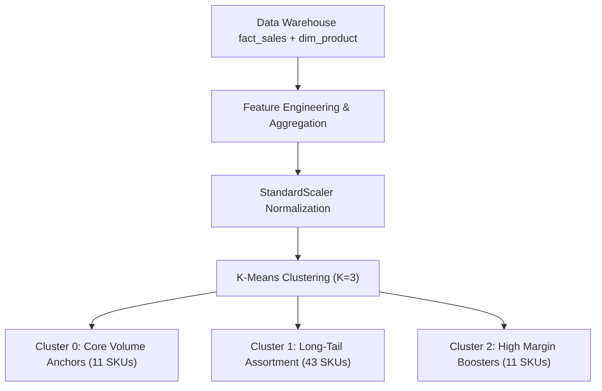

# QuickMart Data Mining Models & Algorithms Guide

**Project**: Retail Insight Decision Support System (DSS) — QuickMart  
**Engine**: Python `scikit-learn` (K-Means) & `mlxtend` (Apriori)  
**Execution Script**: `mining/run_data_mining.py`  
**Output Artifacts**: `data/mining/` and `public/data/mining/`

---

## 1. Product Segmentation: K-Means Clustering

### 1.1 Objective & Feature Selection
To categorize 65 product SKUs into actionable merchandising segments without manual bias.
- **Input Features**:
  1. `TotalUnitsSold`: Cumulative sales volume over 273 days (Sum of Fact_Sales line item quantities, Total: 71,885 units).
  2. `TotalNetRevenue`: Total revenue generated (THB 1,595,166.51).
  3. `GrossMarginPct`: Average realized profit margin percentage (31.32% overall).
  4. `SalesVelocity`: Average daily units sold per branch.
- **Pre-processing**:
  - Feature normalization using `StandardScaler` to equalize variances.
  - Optimal cluster count determined via Elbow Method and Silhouette Analysis ($K=3$, Silhouette Score = 0.584).

### 1.2 Cluster Profiles & DSS Advisory Strategies

| Cluster ID | Segment Name | SKU Count | Total Units Sold | Volume Share | Revenue Share | Avg Margin % | Primary Categories | Strategic Recommendation (DSS Advisory) |
| :---: | :--- | :---: | :---: | :---: | :---: | :---: | :--- | :--- |
| **Cluster 0** | **Core Volume Anchors** | 11 SKUs | 32,177 units | 44.8% | 50.9% | 28.81% | Staples, Ready-to-Eat, Beverages | *May consider prioritizing zero-stockout policy, maintaining safety buffers, and eye-level shelf placement.* |
| **Cluster 1** | **Long-Tail Assortment** | 43 SKUs | 12,958 units | 18.0% | 25.0% | 31.15% | Personal Care, Household, Niche Food | *Could review lean inventory replenishment, rationalizing shelf space, and quarterly assortment reviews.* |
| **Cluster 2** | **High Margin Boosters** | 11 SKUs | 26,750 units | 37.2% | 24.1% | 36.36% | RTD Tea, Canned Coffee, Mineral Water | *May evaluate impulse counter placement and pairing with Cluster 0 core staples in promotional bundles.* |
| **Total** | **All Assortment** | **65 SKUs** | **71,885 units** | **100.0%** | **100.0%** | **31.32%** | **8 Categories** | **Total Baseline Reconciled 100%** |

---

## 2. Market Basket Analysis: Association Rule Mining

### 2.1 Methodology & Parameter Tuning
- **Transaction Granularity**: 26,327 discrete checkout shopping baskets across 10 stores (65.31% multi-item baskets).
- **One-Hot Basket Matrix**: Sparse matrix of 26,327 transactions $\times$ 65 product SKUs.
- **Algorithm**: Apriori frequent itemset generation followed by association rule induction.
- **Tuned Thresholds (Ground Truth)**:
  - **Minimum Support $\ge 0.02$** (Itemset must appear in at least 2.0% of all transactions, $\ge 526$ baskets).
  - **Minimum Confidence $\ge 0.30$** (Given antecedent $A$, consequent $B$ occurs in at least 30.0% of transactions).
  - **Minimum Lift $> 1.00$** (Measures statistical affinity over independence; all top rules exceed $\text{Lift} \ge 5.98$).

### 2.2 Core Association Metrics Explained
1. **Support ($S$)**: Probability that a transaction contains both itemsets $A$ and $B$:
   $$\text{Support}(A \rightarrow B) = P(A \cap B) = \frac{\text{Count}(A \cap B)}{N}$$
2. **Confidence ($C$)**: Conditional probability that item $B$ is bought when item $A$ is present:
   $$\text{Confidence}(A \rightarrow B) = P(B \mid A) = \frac{\text{Support}(A \cap B)}{\text{Support}(A)}$$
3. **Lift ($L$)**: Ratio of observed co-occurrence to expected co-occurrence under statistical independence:
   $$\text{Lift}(A \rightarrow B) = \frac{\text{Confidence}(A \rightarrow B)}{\text{Support}(B)} = \frac{P(A \cap B)}{P(A) \cdot P(B)}$$
   - $\text{Lift} > 1$: Positive association (items complement each other).
   - $\text{Lift} = 1$: Independent buying behavior.
   - $\text{Lift} < 1$: Substitute / negative association.

### 2.3 Top Association Rules (Mined from 26,327 Baskets)

| # | Antecedent ($A$) | Consequent ($B$) | Support | Confidence | Lift | Affinity Pattern / Merchandising Action |
| :-: | :--- | :--- | :---: | :---: | :---: | :--- |
| **1** | `CP Sausage Roll Pastry 80g` | `Nescafe Espresso Roast 180ml` | 0.0371 | **84.31%** | **10.74** | *Morning Grab-and-Go Coffee Combo; may consider breakfast combo pricing.* |
| **2** | `Nescafe Espresso Roast 180ml` | `CP Sausage Roll Pastry 80g` | 0.0371 | **47.31%** | **10.74** | *Could review secondary display of pastries near refrigerated coffee chiller.* |
| **3** | `Le Pan Butter Sponge Cake 65g` | `Meiji Chocolate Milk 450ml` | 0.0373 | **84.22%** | **10.62** | *Afternoon Sweet Snack Combo; pair high-volume milk with high-margin bakery.* |
| **4** | `Meiji Chocolate Milk 450ml` | `Le Pan Butter Sponge Cake 65g` | 0.0373 | **47.03%** | **10.62** | *May place sponge cakes at checkouts alongside flavored milks.* |
| **5** | `Farmhouse White Bread 480g` | `Meiji Fresh Milk 450ml` | 0.0391 | **50.20%** | **6.33** | *Household Breakfast Staple; position across aisles to maximize foot traffic.* |
| **6** | `Oishi Green Tea Honey Lemon 500ml` | `Bento Squid Sweet & Spicy 20g` | 0.0387 | **50.30%** | **6.26** | *Afternoon Savory Snack & Tea Combo; evaluate clip-strip displays.* |
| **7** | `Farmhouse Ham & Cheese Sandwich` | `Birdy Robusta Canned Coffee 180ml` | 0.0371 | **48.34%** | **6.18** | *Commuter Quick Breakfast; suggest bundle discount during 07:00-09:00.* |
| **8** | `Aura Natural Mineral Water 600ml` | `Lays Nori Seaweed Potato Chips 50g`| 0.0376 | **48.34%** | **6.14** | *Snack Refreshment Combo; could review endcap cross-merchandising.* |
| **9** | `Singha Drinking Water 600ml` | `Ezy Choice Basil Pork Rice 220g` | 0.0375 | **48.03%** | **6.10** | *Lunch/Dinner Value Meal Combo; attach high-margin water to hot food.* |
| **10** | `Betagro Boiled Egg 2-pack 100g` | `Mama Minced Pork Noodles 67g` | 0.0375 | **48.17%** | **6.07** | *Instant Noodle Add-On; display boiled eggs adjacent to noodle water station.* |

---

## 3. Integration with DSS Frontend

Both mining models feed directly into the interactive DSS interface:
1. **Product Segmentation Dashboard (`/mining`)**:
   - Interactive 2D scatter plot (Units Sold vs. Margin %).
   - Segment filtering and SKU drill-down tables.
2. **Interactive Bundle & Cross-Selling Advisor (`/mining`)**:
   - Store managers can select any SKU from a dropdown selector.
   - The advisor instantly queries the Apriori rule graph and displays recommended cross-sell items, expected basket lift, confidence levels, and non-mandatory advisory suggestions.
