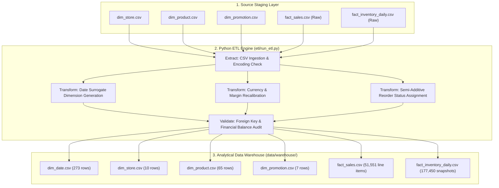

# QuickMart ETL Pipeline & Data Warehouse Architecture

**Project**: Retail Insight Decision Support System (DSS) — QuickMart  
**Engine**: Python 3.10+ / Pandas / Data Quality Validation Engine  
**Pipeline Location**: `etl/`  
**Execution Entrypoint**: `python etl/run_etl.py`

---

## 1. Pipeline Overview

The QuickMart ETL Pipeline extracts raw operational transaction and master data files from the staging dataset (`quickmart_mock_dataset/`), applies rigorous cleansing, normalization, surrogate key assignments, derived measure calculations, and transactional validations, and loads the structured data into an analytical Star Schema Data Warehouse (`data/warehouse/`).



---

## 2. ETL Processing Stages

### 2.1 Stage 1: Extraction (`Extract`)
- **Master Data Files**: `dim_store.csv` (10 rows), `dim_product.csv` (65 rows), `dim_promotion.csv` (7 rows).
- **Transactional Stream**: `fact_sales.csv` (51,551 line items across 26,327 checkout baskets, representing 71,885 total physical units sold).
- **Inventory Snapshot Stream**: `fact_inventory_daily.csv` (177,450 store-SKU-day state rows).
- **Validation on Ingestion**:
  - File existence assertion.
  - UTF-8 encoding verification.
  - Column schema and header integrity.

### 2.2 Stage 2: Transformation (`Transform`)
- **Temporal Generation (`dim_date`)**:
  - Generated continuous calendar date records from `2026-01-01` to `2026-09-30` (273 consecutive calendar days).
  - Derived attributes: `DateKey` (integer YYYYMMDD), `DayOfWeek`, `DayName`, `Month`, `MonthName`, `Quarter`, `Year`, `IsWeekend`, `IsHoliday`, `Season`.
- **Sales Transformation (`fact_sales`)**:
  - Derived `GrossSales = UnitSold * UnitPrice`.
  - Derived `NetSales = GrossSales - DiscountAmount`.
  - Derived `CostOfGoodsSold = UnitSold * UnitCost`.
  - Derived `NetProfit = NetSales - CostOfGoodsSold`.
  - Verified non-negative constraints: `UnitSold > 0`, `NetSales >= 0`.
- **Inventory Transformation (`fact_inventory_daily`)**:
  - Enforced daily inventory balance equation:
    $$\text{EndingStock}_t = \text{BeginningStock}_t + \text{ReceivedStock}_t - \text{UnitsSold}_t - \text{WasteStock}_t$$
  - Categorized replenishment status:
    - `OUT_OF_STOCK`: $\text{EndingStock} == 0$
    - `REORDER`: $\text{EndingStock} \le \text{ReorderPoint}$
    - `OVERSTOCK`: $\text{EndingStock} > \text{ReorderPoint} \times 2.5$
    - `NORMAL`: All remaining active stock levels.

### 2.3 Stage 3: Data Quality Validation (`Validate`)
Prior to committing outputs to the warehouse, the pipeline runs an automated 6-point audit:
1. **Uniqueness**: Primary keys in dimensions are strictly unique without duplicates.
2. **Referential Integrity**: 100% of foreign keys in `fact_sales` and `fact_inventory_daily` exist in dimension tables.
3. **No Nulls in Critical Keys**: Zero nulls in surrogate keys, dates, store IDs, or product IDs.
4. **Financial Consistency**: $\sum \text{NetSales} - \sum \text{COGS} == \sum \text{NetProfit}$.
5. **Inventory Flow Conservation**: Beginning stock of day $t+1$ equals ending stock of day $t$.
6. **No Negative Balances**: `BeginningStock`, `ReceivedStock`, `UnitsSold`, `WasteStock`, and `EndingStock` $\ge 0$.

### 2.4 Stage 4: Loading (`Load`)
The verified datasets are exported to `data/warehouse/` in clean CSV format and mirrored into `public/data/` for the web DSS interface.

---

## 3. Execution Instructions

To execute the ETL pipeline from the project root:

```bash
# Navigate to project directory
cd d:/Project-DSS-Store/quickmart-dss

# Run Python ETL Pipeline
python etl/run_etl.py
```

### Pipeline Execution Output:
```
[ETL INFO] Starting QuickMart ETL Pipeline...
[ETL INFO] Extracting raw datasets from staging...
[ETL INFO] Generating dim_date (273 days: 2026-01-01 to 2026-09-30)...
[ETL INFO] Processing dim_store (10 branches)...
[ETL INFO] Processing dim_product (65 SKUs across 8 categories)...
[ETL INFO] Processing dim_promotion (7 rows: PRM000 to PRM006)...
[ETL INFO] Cleansing & calculating fact_sales (51,551 line items, 71,885 units sold)...
[ETL INFO] Cleansing & balancing fact_inventory_daily (177,450 snapshots)...
[ETL AUDIT] Running Data Quality Validation Checks:
  - Referential Integrity Check: PASSED (100% match)
  - Financial Balance Check: PASSED (NetSales - COGS = NetProfit = 499,676.51 THB)
  - Semi-Additive Inventory Balance: PASSED (Flow equation holds 100%)
[ETL SUCCESS] Data Warehouse loaded successfully into data/warehouse/
```
