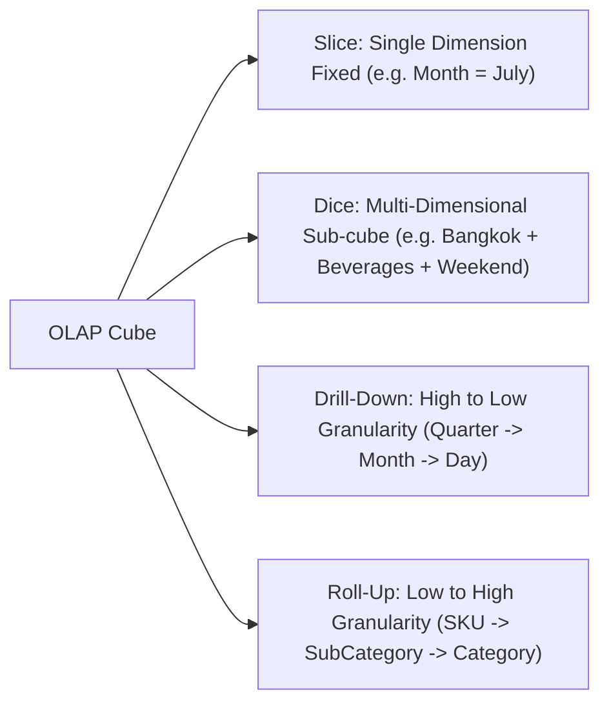

# QuickMart OLAP Multi-Dimensional Analysis Guide

**Project**: Retail Insight Decision Support System (DSS) — QuickMart  
**Engine**: Python OLAP Aggregator (`olap/run_olap.py`) & Client-Side Interactive Engine  
**Data Artifacts**: `data/olap/` and `public/data/olap/`

---

## 1. OLAP Operations Defined

The QuickMart DSS OLAP engine enables retail decision-makers to analyze multi-dimensional sales and inventory metrics across four core operations:



### 1.1 Slice (ระนาบมิติเดียว)
- **Definition**: Fixing a single dimension to a specific coordinate to view a 2D cross-section.
- **Example in QuickMart DSS**:
  - Filter `dim_date.Month = 7` (July 2026) to inspect sales performance exclusively across categories and stores for that month.
  - Filter `dim_product.Category = 'Beverages'` to isolate cold drink sales across all 10 branches.

### 1.2 Dice (กล่องมิติย่อย)
- **Definition**: Selecting specific sub-ranges across two or more dimensions simultaneously to isolate a specialized sub-cube.
- **Example in QuickMart DSS**:
  - Selecting `Region IN ('Central', 'North')` **AND** `Category = 'Ready-to-Eat'` **AND** `IsWeekend = TRUE`.
  - Used by store managers to assess convenience meal rush on tourist/CBD weekends.

### 1.3 Drill-Down (เจาะลึกรายละเอียด)
- **Definition**: Navigating down a dimension hierarchy from coarse to fine granularity.
- **Example in QuickMart DSS**:
  - **Temporal Drill-down**: `Year (2026)` $\rightarrow$ `Quarter (Q2)` $\rightarrow$ `Month (April)` $\rightarrow$ `Songkran Festival Days (April 13–15)`.
  - **Product Drill-down**: `Category (Instant Food)` $\rightarrow$ `SubCategory (Cup Noodles)` $\rightarrow$ `SKU (Mama Tom Yum 60g)`.

### 1.4 Roll-Up (สรุปรวมภาพกว้าง)
- **Definition**: Aggregating fine-grained details up a dimension hierarchy into executive summaries.
- **Example in QuickMart DSS**:
  - Aggregating individual line-item transactions up to branch-level totals, then rolling up 10 branches into Regional Performance summaries (`Central`, `North`, `Northeast`, `South`, `East`).

---

## 2. Key OLAP Analytical Cubes

The DSS pre-computes and provides real-time client-side interactive cubes:

### 2.1 Category x Region Sales Matrix (`sales_by_category_region.json`)
Exposes cross-tabulated revenue and margin contribution:
- **Central Region (Bangkok CBD & Residential)**: Accounts for the highest gross volume (฿640,000+), led by Ready-to-Eat and Beverages.
- **South Region (Phuket/Krabi Tourist)**: Demonstrates the highest average ticket value and premium snack demand.

### 2.2 Regional Fairness Metric: Total vs. Average per Store
> [!IMPORTANT]
> **Regional Fairness Principle**
> - In networks where regions have unequal branch counts (e.g., Central has 4 stores, whereas North has only 2), comparing **Total Regional Sales** biases judgment toward high-store regions.
> - QuickMart DSS provides an **Average Revenue per Store** toggle:
>   $$\text{Avg Revenue per Store}_{\text{region}} = \frac{\sum_{s \in \text{Region}} \text{NetSales}_s}{|\text{Stores in Region}|}$$
> - This normalizes branch productivity and reveals true store efficiency.

### 2.3 Monthly Sales & Margin Seasonality Trend (`monthly_sales_trend.json`)
Tracks the evolution of sales revenue, profit margin percentage, and transaction volumes from January through September 2026. Peak revenue occurs in April (Songkran Holiday Season), while highest margin percentage is sustained in ready-to-eat and personal care categories.

### 2.4 Promotion Effectiveness Cube (`promo_effectiveness.json`)
Compares promotional campaigns (`PRM001` through `PRM006`, 7 rows total in `dim_promotion`) against baseline standard pricing (`PRM000`):
- Measures **Sales Lift (%)** vs. **Gross Margin Impact (%)**.
- Evaluates whether discount depth eroded net profit or drove accretive basket volume.

---

## 3. Semi-Additive Inventory OLAP Logic

The DSS handles inventory measures with strict dimensional rules:

```typescript
// Snapshot Rule (Point-in-Time: End of Q3 2026-09-30)
const currentChainStock = inventoryData
  .filter(item => item.DateKey === 20260930)
  .reduce((sum, item) => sum + item.EndingStock, 0); // 29,796 units

// Temporal Average Rule (Mean daily physical stock)
const averageDailyStock = totalStockSumAcrossAllDays / totalRecordCount; // 45.44 units/item/day
```

### Replenishment Priority Engine:
1. **Critical Review / Out of Stock**: $\text{EndingStock} = 0 \rightarrow$ Immediate emergency stock transfer or vendor order.
2. **Reorder Recommended**: $\text{EndingStock} \le \text{ReorderPoint} \rightarrow$ Automated purchase order suggestion.
3. **Overstock Advisory**: $\text{EndingStock} > \text{ReorderPoint} \times 2.5 \rightarrow$ Review storage constraints or consider markdown/bundling.
