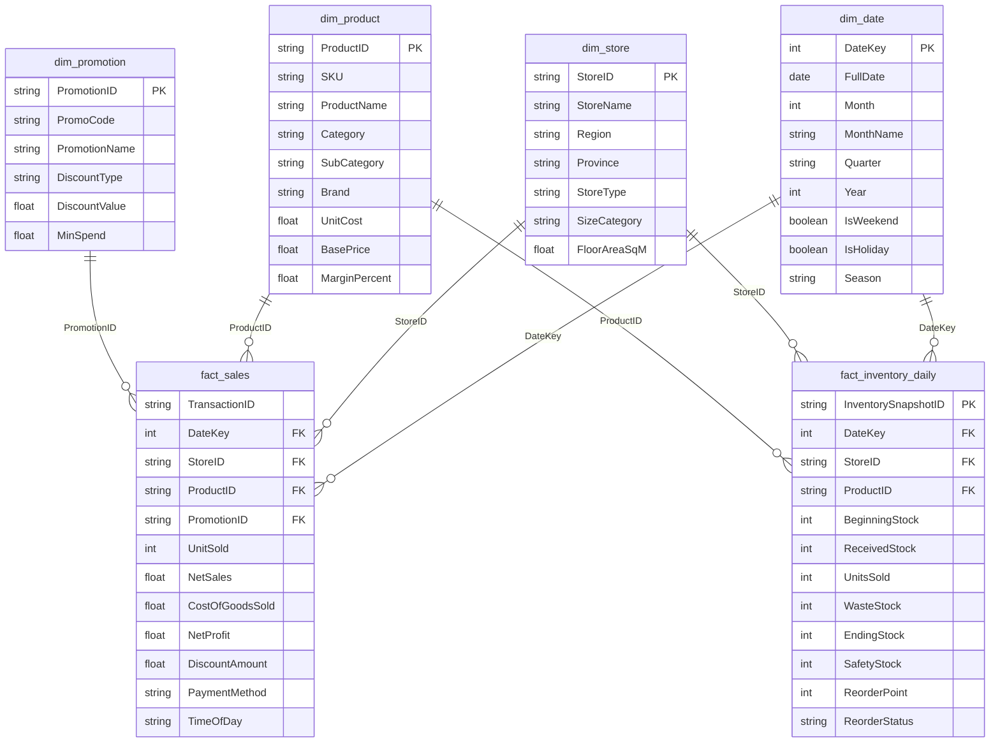

# QuickMart Data Warehouse — Star Schema & Fact Constellation

**Project**: Retail Insight Decision Support System (DSS) — QuickMart  
**Architecture**: Fact Constellation (Galaxy Schema) with Shared Conformed Dimensions  
**Implementation**: Python Pandas ETL Pipeline -> Validated CSV Data Lake / Data Warehouse

---

## 1. Schema Architecture Overview

QuickMart DSS utilizes a **Fact Constellation** architecture featuring **two central fact tables** sharing **four conformed dimension tables**:

1. **`fact_sales`**: Transactional sales line items (51,551 line items across 26,327 checkout baskets, representing 71,885 total physical units sold).
2. **`fact_inventory_daily`**: Periodic daily snapshots (177,450 store-SKU-day state rows across 10 stores, 65 SKUs, and 273 days).
3. **Conformed Dimensions**:
   - `dim_date` (273 rows: Daily time dimension, calendar hierarchy: Day -> Month -> Quarter -> Year)
   - `dim_store` (10 rows: 10 physical branches, geographic hierarchy: Store -> Province -> Region)
   - `dim_product` (65 rows: 65 SKUs, merchandise hierarchy: SKU -> SubCategory -> Category)
   - `dim_promotion` (7 rows: Promotional campaign dimension: `PRM000` to `PRM006`)

---

## 2. Table Details & Cardinality

| Table Name | Role | Cardinality (Rows) | Primary Key / Composite Key | Grain Description |
| :--- | :--- | :--- | :--- | :--- |
| `dim_date` | Conformed Dimension | **273 rows** | `DateKey` | 1 row per calendar day (Jan 1 – Sep 30, 2026) |
| `dim_store` | Conformed Dimension | **10 rows** | `StoreID` | 1 row per physical convenience retail branch |
| `dim_product` | Conformed Dimension | **65 rows** | `ProductID` | 1 row per commercial stock keeping unit (SKU) across 8 categories |
| `dim_promotion` | Conformed Dimension | **7 rows** | `PromotionID` | 1 row per promotional mechanism (`PRM000` to `PRM006`) |
| `fact_sales` | Transaction Fact | **51,551 line items** | (`TransactionID`, `ProductID`) | 1 row per product SKU in checkout basket (Total: 71,885 physical units sold across 26,327 baskets) |
| `fact_inventory_daily`| Periodic Snapshot Fact | **177,450 snapshots** | `InventorySnapshotID` | 1 row per SKU per store per calendar day ($65\text{ SKUs} \times 10\text{ Stores} \times 273\text{ Days}$) |

> [!IMPORTANT]
> **Grain & Record Distinction**:
> - `fact_sales` contains exactly **51,551 line item records** (baskets $\times$ distinct SKUs per basket).
> - **71,885** is the cumulative **Total Units Sold** ($\sum \text{UnitSold}$), as individual line items frequently contain quantities $> 1$.
> - **71,885 must NEVER be referred to as the sales record count**.

---

## 3. Dimension Hierarchies for OLAP Navigation

### 3.1 Temporal Hierarchy (`dim_date`)
`Day (DateKey)` -> `Month (MonthName / Month)` -> `Quarter (Q1, Q2, Q3)` -> `Year (2026)`
* Enables **Roll-up** from daily sales spikes to monthly seasonality trends and quarterly board reviews.
* Enables **Drill-down** from quarterly performance into specific high-volume holiday weekends (Songkran, New Year).

### 3.2 Product Hierarchy (`dim_product`)
`SKU (ProductID)` -> `SubCategory` -> `Category (8 Merchandise Categories)` -> `Total Retail Catalog`
* Enables category-level cross-comparison (e.g., Beverages vs. Snacks margin contribution) and drilling down to SKU-level velocity.

### 3.3 Spatial / Store Hierarchy (`dim_store`)
`Branch (StoreID)` -> `Province (Bangkok, Chiang Mai, etc.)` -> `Region (5 Macro Regions)` -> `Chain Total`
* Enables regional performance comparison and fairness metric evaluation (Total Revenue vs. Average Revenue per Branch).

---

## 4. Semi-Additive Measure Ground Rules

> [!CAUTION]
> **Semi-Additive Nature of Inventory Measures**
> - **`BeginningStock`** and **`EndingStock`** are point-in-time state indicators.
> - **DO NOT SUM ACROSS TIME**: Summing ending stock across 273 days produces a meaningless inflated metric.
> - **Permitted Aggregations**:
>   - Sum across `StoreID` or `Category` for a **specific fixed date** (Point-in-Time Snapshot):
>     $$\text{Total Chain Stock}_{t=2026-09-30} = \sum_{s \in \text{Stores}} \sum_{p \in \text{Products}} \text{EndingStock}_{s,p,t} = \mathbf{29,796\text{ units}}$$
>   - Average across time for a store or SKU (Daily Average Stock):
>     $$\overline{\text{EndingStock}} = \frac{1}{|T|} \sum_{t \in T} \text{EndingStock}_{s,p,t} = \mathbf{45.44\text{ units/item/day}}$$
> - **Flow measures** such as `ReceivedStock`, `UnitsSold`, and `WasteStock` are **fully additive** across all dimensions including time.

---

## 5. Star Schema Integrity & Validation Rules

1. **Foreign Key Referential Integrity**: 100% of foreign keys in `fact_sales` and `fact_inventory_daily` map directly to existing records in dimensions.
2. **Sales Additive Conservation**:
   $$\text{GrossSales} = \text{UnitSold} \times \text{UnitPrice}$$
   $$\text{NetSales} = \text{GrossSales} - \text{DiscountAmount}$$
   $$\text{NetProfit} = \text{NetSales} - (\text{UnitSold} \times \text{UnitCost})$$
3. **Daily Inventory Flow Balance**:
   $$\text{EndingStock}_t = \text{BeginningStock}_t + \text{ReceivedStock}_t - \text{UnitsSold}_t - \text{WasteStock}_t$$
   $$\text{BeginningStock}_{t+1} = \text{EndingStock}_t$$

---

## 6. Reconciliation Baseline Ground Truth

| Metric | Validated Baseline Value | Formulation Source | Status |
| :--- | :---: | :--- | :---: |
| **Dim_Date Rows** | **273** | Daily calendar entries | **100% MATCH** |
| **Dim_Product SKUs** | **65** | Assortment across 8 categories | **100% MATCH** |
| **Dim_Store Branches** | **10** | 10 stores across Thailand | **100% MATCH** |
| **Dim_Promotion Rows** | **7** | `PRM000` to `PRM006` | **100% MATCH** |
| **Fact_Sales Line Items** | **51,551** | Transaction item rows | **100% MATCH** |
| **Fact_Inventory Snapshots**| **177,450** | $65 \times 10 \times 273$ daily records | **100% MATCH** |
| **Total Units Sold** | **71,885** | $\sum \text{UnitSold}$ (Fact_Sales) | **100% MATCH** |
| **Total Checkout Baskets** | **26,327** | Distinct `TransactionID` | **100% MATCH** |
| **Total Net Sales** | **฿1,595,166.51** | $\sum \text{NetSales}$ | **100% MATCH** |
| **Total Net Profit** | **฿499,676.51** | $\sum \text{NetProfit}$ | **100% MATCH** |
| **Profit Margin %** | **31.32%** | $(\text{Profit} / \text{Sales}) \times 100$ | **100% MATCH** |
| **Current Stock (Snapshot)**| **29,796 units** | Ending Stock on Sep 30, 2026 | **100% MATCH** |
